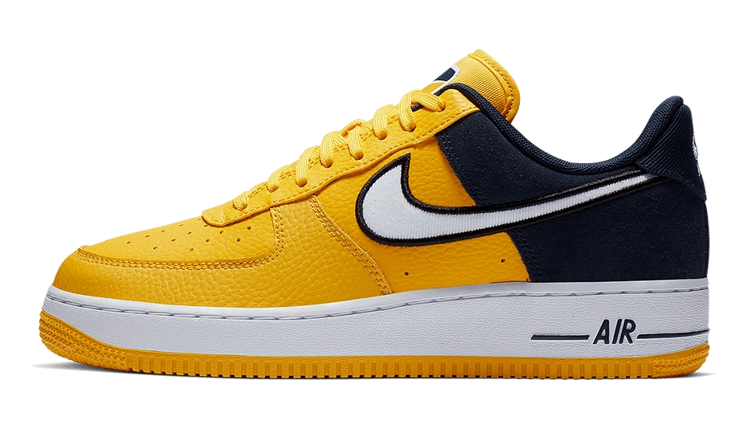

# Nike - Design com Tailwind

Peça promocional de um tênis da Nike, estilizada apenas com Tailwind CSS como projeto de estudo.

🔗 **Demo:** https://matheusdiamantino.github.io/Design-Nike-Tailwind/



## O que foi praticado

- **Tailwind CSS 3** via CLI, com animações customizadas no `tailwind.config.js`
- Efeitos de hover com `group-hover`

## Como rodar

```bash
npm install
npm run dev   # gera styles/output.css em modo watch
```

Depois, sirva a pasta raiz com um servidor local (ex.: Live Server) e abra `src/index.html`.
